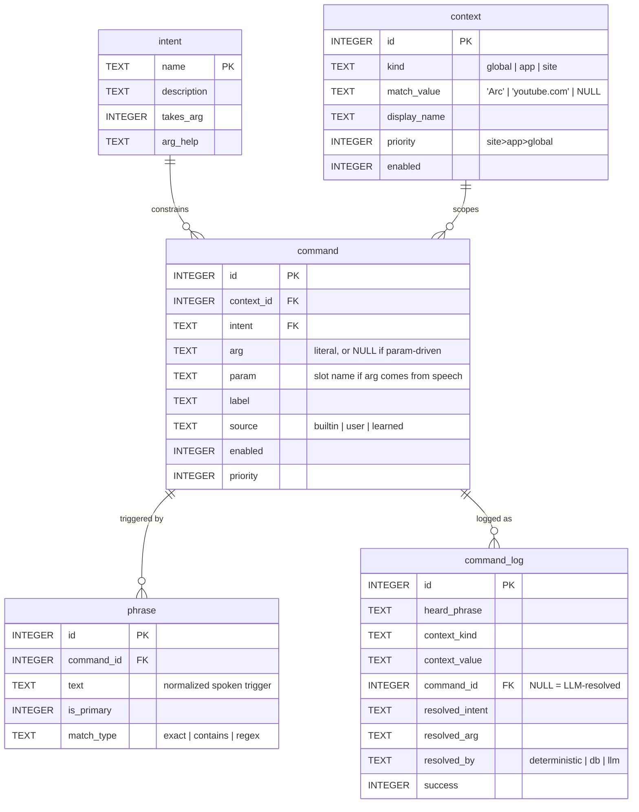

# Command database — app/site-scoped voice commands (schema design)

> **Status:** 📋 design for review. **No code yet** — this is the schema + docs to look over
> before we build. Implements the storage half of **idea #36** (context-aware command profiles)
> on the **SQLite** direction from **idea #27**; sets up the learning layer of **#14**.
>
> **What we're building toward:** the same voice command set adapts to *what app you're on*. Focus
> **Arc** → tab-switching, profile-switching, "open YouTube", "open GitHub" are live. Focus
> **Cursor** → a different set. The DB is the store those per-app command sets live in.

---

## 1. Goal & scope of this step

You already shipped the "what app am I on?" view (`actions.frontmost_app()` /
`environment_context()`). This step adds the **store** behind app-specific commands: a single
SQLite file (`data/commands.db`) holding, per context (app/site/global), a set of spoken commands
and what each one does.

**This doc covers only the schema** — tables, columns, types, foreign keys, relationships, sample
data, and how it plugs into the existing command flow. Implementation (loading the DB, the lookup,
seeding, the dashboard editor) comes *after* you review this.

**Why SQLite:** single file, ships with Python's stdlib `sqlite3` (no dependency — matters for the
open-source download, idea #27), queryable, transactional, and easy to browse/edit from the
dashboard later. Today's stores are JSON under `data/`; this is the first structured store to move
to SQLite, and a template for migrating `rules`/`usage` later.

> **The complete list of commands to seed** — every current command split into always-on / global /
> app-specific (browser) — is in the companion [`command-inventory.md`](command-inventory.md).

---

## 2. How it maps to the command system we already have

The runtime model today (`src/vox/actions.py`):

```
utterance ──parse()──▶ (intent, arg) ──_run() dispatch──▶ handler ──▶ result
                         e.g. ("navigate", "https://youtube.com")
```

- **`intent`** = one of 18 built-in handlers (the keys of the `_run` dispatch map): `navigate`,
  `navigate_new`, `search`, `back`, `tab`, `tab_arrow`, `tab_index`, `window`, `window_move`,
  `window_index`, `desktop_move`, `desktop_index`, `profile`, `profile_move`, `app_cycle`,
  `sidebar`, `close_tab`, `click`.
  Those 18 are `category='action'` intents. The DB's `intent` table *also* holds the **mode** intents
  (`enter_control`, `enter_assistant`, `enter_dictation`) and **system** intents (`sleep`, `abort`,
  `quit`, `restart`, `dashboard_open`, `dashboard_close`) — consumed by the loop, not `_run` (§8a).
- **`arg`** = the handler's parameter (`"https://youtube.com"`, `"down:1"`, `"next"`, a search query…).
- **Context today** = `frontmost_app()` (focused app) + `_active_tab()`/`_domain()` (active tab's
  title + domain). Already computed; nothing new needed to *know* the context.

**The DB stores `(context → phrase → intent + arg)` rows.** So a command is just: "in this context,
when you say one of these phrases, run this built-in handler with this argument." We are **not**
replacing the regex parser — the DB is an additive, per-app lookup layer *in front of* it (see §6).
Every `intent` the DB can reference is a handler that already exists.

---

## 3. The tables at a glance

| Table | Holds | Key relationships |
|---|---|---|
| **`intent`** | The built-in handler vocabulary (reference/lookup) | `command.intent → intent.name` |
| **`context`** | *When* a command applies: global / an app / a site | `command.context_id → context.id` |
| **`command`** | *What* it does: a context-scoped action (intent + arg) | belongs to one `context`, one `intent` |
| **`phrase`** | *How you say it*: spoken triggers (many per command) | `phrase.command_id → command.id` |
| **`command_log`** | *(phase 2, learning #14)* every resolution, to graduate LLM hits into commands | `command_log.command_id → command.id` |

### Entity-relationship diagram



**Relationship summary (the foreign keys):**
- `command.context_id` → `context.id` **(ON DELETE CASCADE)** — delete a context, its commands go.
- `command.intent` → `intent.name` — a command can only use a handler that exists.
- `phrase.command_id` → `command.id` **(ON DELETE CASCADE)** — delete a command, its phrases go.
- `command_log.command_id` → `command.id` **(ON DELETE SET NULL)** — keep the log even if the
  command is later deleted.

---

## 4. Full schema (SQLite DDL) — for review

```sql
-- ─────────────────────────────────────────────────────────────────────────────
-- Vox command database — app/site-scoped voice commands (ideas #36, #27, #14)
-- One file: data/commands.db   ·   stdlib sqlite3, no dependency
-- ─────────────────────────────────────────────────────────────────────────────
PRAGMA foreign_keys = ON;   -- SQLite enforces FKs only when this is ON per connection

-- The built-in handler vocabulary. Mirrors the dispatch map in actions._run, so a
-- command can't reference a handler that doesn't exist. Seeded once from code.
CREATE TABLE intent (
    name        TEXT PRIMARY KEY,             -- 'navigate', 'tab_arrow', 'sleep', 'quit', …
    category    TEXT NOT NULL DEFAULT 'action'
                CHECK (category IN ('action','mode','system')),
                -- 'action' = dispatched via actions._run (navigate, tab_arrow, click, …)
                -- 'mode'   = switch mode (enter_control, enter_assistant, enter_dictation)
                -- 'system' = consumed by the loop (sleep, abort, quit, restart, dashboard_*)
    description TEXT NOT NULL,
    takes_arg   INTEGER NOT NULL DEFAULT 1,   -- 0 = handler ignores arg (e.g. back, close_tab, sleep)
    arg_help    TEXT                          -- hint: 'URL', 'up:1 | down:N', 'query', 'app name'
);

-- WHEN a command applies (the focus context). 'global' = everywhere; 'app' keyed by
-- the macOS app name (frontmost_app); 'site' keyed by the active tab's domain.
CREATE TABLE context (
    id           INTEGER PRIMARY KEY,
    kind         TEXT    NOT NULL CHECK (kind IN ('global','app','site')),
    match_value  TEXT,                         -- 'Arc' | 'youtube.com' | NULL for global
    display_name TEXT    NOT NULL,             -- 'Everywhere' | 'Arc' | 'YouTube'
    priority     INTEGER NOT NULL DEFAULT 0,   -- resolution order: site(20) > app(10) > global(0)
    enabled      INTEGER NOT NULL DEFAULT 1,
    created_at   TEXT    NOT NULL DEFAULT (datetime('now')),
    updated_at   TEXT    NOT NULL DEFAULT (datetime('now')),
    UNIQUE (kind, match_value)                 -- one context per app/site; one global row
);

-- WHAT a command does: a context-scoped action (intent + fixed arg). One logical
-- command; its spoken triggers live in `phrase`.
CREATE TABLE command (
    id          INTEGER PRIMARY KEY,
    context_id  INTEGER NOT NULL REFERENCES context(id) ON DELETE CASCADE,
    intent      TEXT    NOT NULL REFERENCES intent(name),
    arg         TEXT,                           -- literal: 'https://youtube.com', 'down:1'; NULL if param-driven
    param       TEXT,                           -- slot name when arg comes from speech ('query'); NULL = fixed
    label       TEXT    NOT NULL,               -- human name: 'Open YouTube', 'Next tab'
    source      TEXT    NOT NULL DEFAULT 'builtin'
                        CHECK (source IN ('builtin','user','learned')),
    enabled     INTEGER NOT NULL DEFAULT 1,
    priority    INTEGER NOT NULL DEFAULT 0,     -- tie-break within a context
    created_at  TEXT    NOT NULL DEFAULT (datetime('now')),
    updated_at  TEXT    NOT NULL DEFAULT (datetime('now'))
);
CREATE INDEX idx_command_context ON command(context_id);

-- HOW you say it: spoken triggers/aliases. Many phrases → one command.
CREATE TABLE phrase (
    id          INTEGER PRIMARY KEY,
    command_id  INTEGER NOT NULL REFERENCES command(id) ON DELETE CASCADE,
    text        TEXT    NOT NULL,               -- normalized: 'open youtube', 'next tab'
    is_primary  INTEGER NOT NULL DEFAULT 0,     -- canonical phrase shown in the dashboard
    match_type  TEXT    NOT NULL DEFAULT 'exact'
                        CHECK (match_type IN ('exact','contains','regex')),
    created_at  TEXT    NOT NULL DEFAULT (datetime('now')),
    UNIQUE (command_id, text)
);
CREATE INDEX idx_phrase_text ON phrase(text);

-- (PHASE 2 — learning, idea #14) Every resolution, so repeated LLM hits on the same
-- (phrase, context) can graduate into a `command` row with source='learned'.
CREATE TABLE command_log (
    id              INTEGER PRIMARY KEY,
    ts              TEXT    NOT NULL DEFAULT (datetime('now')),
    heard_phrase    TEXT    NOT NULL,
    context_kind    TEXT,                        -- 'app' | 'site' | 'global' at the time
    context_value   TEXT,                        -- 'Arc' | 'youtube.com' | NULL
    command_id      INTEGER REFERENCES command(id) ON DELETE SET NULL,  -- NULL = LLM-resolved
    resolved_intent TEXT,
    resolved_arg    TEXT,
    resolved_by     TEXT CHECK (resolved_by IN ('deterministic','db','llm')),
    success         INTEGER
);
```

---

## 5. What the data looks like — Arc example

**`context`**

| id | kind | match_value | display_name | priority | enabled |
|---|---|---|---|---|---|
| 1 | global | *(null)* | Everywhere | 0 | 1 |
| 2 | app | Arc | Arc | 10 | 1 |
| 3 | site | youtube.com | YouTube | 20 | 1 |

**`command`** (a few rows)

| id | context_id | intent | arg | param | label | source |
|---|---|---|---|---|---|---|
| 10 | 2 (Arc) | tab_arrow | down:1 | *(null)* | Next tab | builtin |
| 11 | 2 (Arc) | tab_arrow | up:1 | *(null)* | Previous tab | builtin |
| 12 | 2 (Arc) | sidebar | show | *(null)* | Show tabs | builtin |
| 13 | 2 (Arc) | close_tab | *(null)* | *(null)* | Close tab | builtin |
| 14 | 2 (Arc) | profile_move | next | *(null)* | Next profile | builtin |
| 20 | 1 (global) | navigate | https://youtube.com | *(null)* | Open YouTube | builtin |
| 21 | 1 (global) | navigate | https://github.com | *(null)* | Open GitHub | builtin |
| 30 | 1 (global) | search | *(null)* | query | Web search | builtin |
| 31 | 3 (YouTube) | search | *(null)* | query | Search YouTube | builtin |

**`phrase`** (triggers for a few of those commands)

| id | command_id | text | is_primary | match_type |
|---|---|---|---|---|
| 100 | 10 | next tab | 1 | exact |
| 101 | 10 | tab forward | 0 | exact |
| 102 | 11 | previous tab | 1 | exact |
| 103 | 12 | show tabs | 1 | exact |
| 104 | 12 | show sidebar | 0 | contains |
| 110 | 20 | open youtube | 1 | exact |
| 111 | 20 | open you tube | 0 | exact |  ← common Whisper split
| 120 | 30 | search | 1 | regex |  ← captures the query into `param`
| 121 | 31 | search | 1 | regex |

> **The headline feature in one example:** command 30 (global "search" → web) and command 31
> (YouTube-site "search" → search YouTube) share the **same phrase** "search". When you're on
> youtube.com, the site context (priority 20) wins over global (priority 0) — so *the same words do
> the right thing for where you are*. That's idea #36, delivered by the schema.

---

## 6. How a command resolves at runtime (the flow this schema feeds)

This is **additive** — it sits in front of today's parser, doesn't replace it:

```
utterance
   │
   ├─ 1. read context: app = frontmost_app(); domain = _domain(active tab url)
   │
   ├─ 2. candidate contexts, highest priority first:
   │        site(domain)  →  app(app)  →  global        (only enabled ones)
   │
   ├─ 3. look up phrases in those contexts (exact, then contains/regex);
   │        first match in the highest-priority context wins
   │        → run command.intent with command.arg
   │                                  (or the captured `param` for regex phrases)
   │
   ├─ 4. no DB match → fall through to the existing actions.parse() regex cascade
   │
   └─ 5. still nothing → the LLM executor (unchanged)
            └─ (phase 2) log the resolution to command_log for learning (#14)
```

Key properties:
- **Nothing existing breaks.** If the DB is empty or missing, step 3 finds nothing and everything
  behaves exactly as today (step 4/5).
- **Per-app override.** An Arc-context "search" could shadow the global one — precedence by context
  priority, then `command.priority` as a tie-break.
- **Fast.** Matching is **in-memory** (see §6a) — no DB query in the hot path.

---

## 6a. Command loading & caching — the hot path NEVER queries the DB

The idle loop hears a *lot* of ambient speech (talking to people, a YouTube video). Step 3 above must
**never** mean "hit SQLite on every utterance" — that would burn power transcribing *and* querying
all day. So the DB is the **source of truth**, but it's read into **memory** and matched there. Three
load points, and that's all:

1. **At boot — load the always-needed sets once.** Read the **Tier-0 (mode/system)** commands and the
   **global** commands into memory, merged with the hardcoded safety-floor defaults (§8a). The idle
   loop then matches against this in-memory set — exactly as cheap as today's `cfg.*_phrases` tuples
   (a substring check), with **zero DB hits**. *(This is your "grab the important overhead commands at
   startup, keep them in memory, query the DB only for everything else" idea — adopted.)*
2. **On focus change — load the active app's set.** When `frontmost_app()` changes (you switch to
   Slack), load that app/site context's commands into the cache, keyed by app name. Same app next
   utterance → reuse the cache (no DB). So the DB is touched only when you actually *switch apps*.
3. **On edit — refresh.** When a command is added/edited (dashboard, or a `learned` write), invalidate
   the relevant cache entry so the change takes effect without a restart.

```
boot ──▶ [ in-memory: safety-floor ∪ Tier-0 ∪ global ]      ← matched on EVERY utterance, no DB
switch to Slack ──▶ DB read once ──▶ [ + Slack commands ]   ← cached by app name
edit a command ──▶ invalidate + reload that slice
idle ambient speech ──▶ matched in memory only ──▶ no DB, no LLM   (unchanged cost from today)
```

**Net:** idle stays as light as it is now (the only per-utterance cost is the Whisper transcription
that already happens for wake detection); SQLite is hit at boot, on an app switch, and on an edit —
never in the hot loop. The "everything in the DB" decision (§8) costs nothing at runtime because of
this caching.

---

## 7. Migrating what's already in code

- **`_SITE_ALIASES`** (github, youtube, gmail, …) → seed as **global** `navigate` commands (one
  command per site, `arg` = the URL, primary phrase `"open <site>"`). Makes the hardcoded dict
  user-editable without code changes.
- **`_APP_ALIASES`** (chrome → Google Chrome, …) → stays in code for now (it's name-normalization,
  not a command); could become a small `app_alias` table later if useful.
- **Built-in per-app commands** (tab/window/profile nav) → seed from code into the relevant `app`
  contexts (or keep them in the regex parser and let the DB only hold *added* per-app commands).
  **This is decision (b) below.**

---

## 8. Decisions

1. **Does the DB hold *all* commands, or only per-app additions?** → **RESOLVED: the DB is the single
   source of truth for *all* commands** — global, app-specific, *and* the Tier-0 mode/system commands
   (sleep, wake, dictation, quit, restart). "Everything together," fully editable from the dashboard,
   no command hidden in code. **With one safety rule** (see §8a): the control-plane phrases keep
   hardcoded defaults as a *floor* the DB can only add to, so an empty/broken DB can never lock you
   out. The old "additions-only" option is dropped.
2. **Fixed vs. parameterized commands in phase 1.** Recommended: phase 1 = **fixed-phrase**
   commands only (every example above except 30/31). Keep parameterized grammar ("search X",
   "open <anything>", "go to my X tab") in the code parser; the `param` + `match_type='regex'`
   columns exist so we *can* move them in later, but we don't need to for the first cut.
3. **Are "open YouTube/GitHub" global or Arc-scoped?** Recommended: **global** `navigate` commands
   (opening a site works regardless of focus). The "Arc command set" you picture =
   *Arc-context commands ∪ global commands* (merged at resolution / in the dashboard view). Worth
   confirming this matches your mental model.
4. **Separate `action` table?** I folded the action (intent + arg) into `command` for simplicity
   (rarely do two commands share an identical action). Splitting it out is easy later if needed.
5. **Site context granularity** — domain only (`youtube.com`), or also path (`youtube.com/watch`)?
   Recommended: domain only for phase 1.

---

## 8a. Safety floor — the control plane is never DB-only

Because **all** commands (including mode/system) now live in the DB, the control plane —
`abort` (emergency stop), `quit`, `restart`, and the mode switches — must **never** depend on the DB
being present or correct. The rule:

> **Hardcoded defaults stay in code as a floor; the DB *adds* to them (union), it doesn't replace
> them.** So `emergency stop` / `quit vox` / `restart vox` are *always* active no matter what's in
> (or missing from) the DB, and your custom sleep word ("going to sleep") is simply added alongside
> the built-in "stand down".

This is the **same pattern Vox already uses for settings** — `_setting(key, fallback)` reads the DB
override and falls back to the `Config` default. Here:
- **`action` commands** → the DB is the full source (with the `_SITE_ALIASES` etc. seeded into it).
- **`mode` / `system` commands** → the loop/wake layer reads its trigger phrases as
  *`hardcoded defaults` ∪ `DB phrases`* — code is the floor, the DB extends. (Phrase *removal* of a
  built-in safety phrase is intentionally not supported for now.)

Implementation note: today the loop reads `cfg.control_phrases`, `cfg.sleep_phrases`, etc. directly.
Source-of-truth means swapping those reads for a `phrases_for(category)` lookup that returns the
union above — a thin, mechanical change, gated behind a setting so it's easy to compare.

---

## 9. Future capabilities (documented now, NOT built in phase 1)

Captured so phase 1 doesn't paint us into a corner. Phase 1 = **fixed phrase → single action**;
each of these is an extension of that foundation. The natural build order is **D → C → A/B**.

### A. LLM-learned commands — save what the brain works out
When the deterministic parser misses (a fuzzy phrase, or something not yet wired) it escalates to the
LLM, which resolves it. The future: **persist that resolution as a learned command** so next time
it's instant and deterministic — *carry the command through, no LLM call.* (Your "going to sleep"
example: once the brain maps a phrase to an action, it's always there.)
- **Flow:** LLM resolves `(phrase, context) → intent + arg` → write a `command` row with
  `source='learned'` + its `phrase`, scoped to the context it happened in (or global). The next
  utterance hits the DB lookup (§6 step 3) and skips the LLM.
- **Schema:** already supported — `command.source='learned'`, and `command_log` records every LLM
  resolution as the training signal. A "save this?" confirm, or an auto-threshold (seen N times),
  decides when a log row graduates into a command. **No schema change needed.**

### B. Variable commands — a slot in the phrase
"set an alarm in **20 minutes**" → the time is a **variable**; save it once and "set an alarm in
**X** minutes" always works.
- **Already proven:** the **scheduler is a working variable command** in code (it parses arbitrary
  times/text). The future work is letting the LLM *define new* variable commands generically.
- **Schema:** a **single** variable fits the existing `param` column + `phrase.match_type='regex'`
  (the regex capture group fills `param`, which becomes the handler arg).
- **Multiple** variables in one command (e.g. "move &lt;file&gt; to &lt;folder&gt;") outgrows one
  `param` column → a small child table when we need it:
  ```sql
  CREATE TABLE command_param (
      id          INTEGER PRIMARY KEY,
      command_id  INTEGER NOT NULL REFERENCES command(id) ON DELETE CASCADE,
      name        TEXT    NOT NULL,   -- 'minutes', 'file', 'folder'
      slot        INTEGER NOT NULL,   -- which regex capture group
      UNIQUE (command_id, name)
  );
  ```

### C. Multi-action commands — one phrase → a sequence of steps
"**call Alex**" → (1) open Slack, (2) go to Alex's chat, (3) click the call button. One spoken
command, **several ordered actions**.
- **Schema impact:** the phase-1 "one command = one intent+arg" doesn't cover this. Introduce an
  ordered child table (a command with one step == today's single-action command, so it *generalises*
  rather than replaces):
  ```sql
  CREATE TABLE command_step (
      id          INTEGER PRIMARY KEY,
      command_id  INTEGER NOT NULL REFERENCES command(id) ON DELETE CASCADE,
      seq         INTEGER NOT NULL,                       -- run order: 1, 2, 3…
      intent      TEXT    NOT NULL REFERENCES intent(name),
      arg         TEXT,
      param       TEXT,
      UNIQUE (command_id, seq)
  );
  ```
- This is exactly why **decision #4** (keep the action separable) matters — multi-action is the
  reason. Phase 1 can fold a single inline action and migrate to `command_step` when this lands.

### D. AX-tree command capture — teach a click by demonstration
You deliberately left Slack unconfigured so we can: click a control on Slack once, **save it via the
AX tree**, and bind it to a phrase — so "click &lt;this chat&gt;" replays that exact click next time,
scoped to Slack.
- **Flow:** name/demonstrate a control → Vox reads the AX tree (it already does for `click`/`look`),
  captures a stable handle (role + title + path), and writes a `command` (intent=`click`,
  `arg`=the saved selector) + `phrase` in the **Slack** `app` context.
- **Schema:** fits as a `click` command whose `arg` holds the selector. If selectors get rich (paths
  + fallbacks), promote to an **`element`** table the command references — a later refinement.
- This is the on-ramp to per-app commands for **every** app, and the building block for C
  ("call Alex" = navigate + a couple of captured clicks).

---

## 10. Suggested phasing (after you sign off on the schema)

1. **Schema + seed.** Create `data/commands.db` from this DDL; a `command_store.py` that opens it
   and seeds `intent` (from code) + Tier-0 mode/system commands + the `_SITE_ALIASES` global
   commands + a starter Arc context (per `command-inventory.md`).
2. **Boot-load + runtime lookup.** Load Tier-0 + global into memory at startup and match there
   (§6a — the idle hot path never queries the DB); load app commands on focus change. Wire steps
   1–3 of §6 into the dispatch path (before `actions.parse`), behind a setting to toggle/compare.
3. **Dashboard editor.** A "Commands" tab to browse contexts, add/edit commands + phrases, enable/
   disable — the transparency goal of #27.
4. **Learning.** Turn on `command_log`; surface "you said this 3× and we LLM'd it each time — make
   it a command?" → write a `source='learned'` row (#14).

Everything here is additive and reversible — an empty/missing DB leaves Vox behaving exactly as it
does today.
